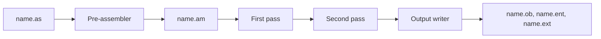
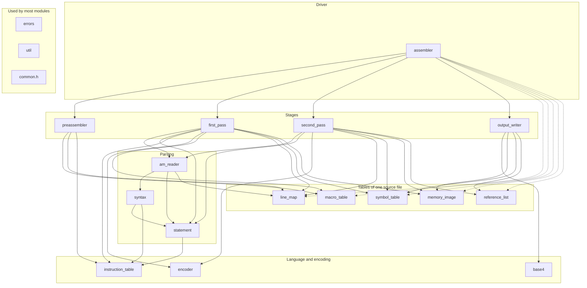

##### B"H

# A two-pass assembler in C90

[](https://github.com/RachelyGlb/assembler-project/actions/workflows/demo.yml)

This is an assembler for an imaginary 10-bit machine, written in strict C90.
It expands macros, translates the program in two passes and writes the
machine code in a base 4 notation, together with the lists of exported and
imported symbols that a linker would need. The project started as a
university systems-programming course assignment and was then rebuilt from
scratch against a written specification, with a test suite derived from that
specification.

**Live demo: <https://rachelyglb.github.io/assembler-project/>**

The demo page is generated by running the compiled assembler on programs of
the test suite. For every example it shows the source, the files the run
produced and every machine word decoded into its fields.

## An example

The file `count.as`:

```
; Count down from 3 and print the text at MSG on every round.
.entry LOOP
.extern PRINT
mcro next
        dec r1
        bne LOOP
mcroend
MAIN:   mov #3, r1
LOOP:   lea MSG, r2
        jsr PRINT
        next
        stop
MSG:    .string "hi"
```

Running `./assembler count` prints nothing and writes four files. The
pre-assembler removes the macro definition and replaces the call `next` by
its two body lines, which gives `count.am`. The object file `count.ob` is:

```
db	d
bcba	aaada
bcbb	aaada
bcbc	aaaba
bcbd	babda
bcca	bdabc
bccb	aaaca
bccc	cdaba
bccd	aaaab
bcda	caada
bcdb	aaaba
bcdc	ccaba
bcdd	bcbdc
bdaa	ddaaa
bdab	abcca
bdac	abccb
bdad	aaaaa
```

The first line holds the number of code words and the number of data words
(`db` is 13 and `d` is 3). Every other line holds an address and the word
stored there. The code starts at address 100, which is `bcba`. The word
`aaaab` at address `bccd` (107) stands for the external symbol `PRINT`: its
address bits are zero and the linker is expected to fill them in.

`count.ent` lists the symbols this file exports and `count.ext` lists every
word that refers to a symbol of another file:

```
LOOP	bcbd
```

```
PRINT	bccd
```

A file with errors gets one message for every faulty line and no object file:

```
MAIN:   mov #300, r1
        jmp
        lea #1, r2
        stop
```

```
bad.as:1: error: the immediate operand '#300' is out of range; an immediate operand holds -128 to 127
bad.as:2: error: an operand is missing; the operation takes 1
bad.as:3: error: the source operand is an immediate value, which the operation does not allow
```

## The machine and the language

- **Words and memory.** A word has 10 bits. The memory has 256 words, at
  addresses 0 to 255, and a program is built to be loaded from address 100.
  Numbers are stored in two's complement.
- **Registers.** There are eight general registers, `r0` to `r7`.
- **Operations.** There are 16 operations: `mov`, `cmp`, `add`, `sub` and
  `lea` take two operands; `clr`, `not`, `inc`, `dec`, `jmp`, `bne`, `jsr`,
  `red` and `prn` take one; `rts` and `stop` take none.
- **Addressing modes.** An operand is an immediate value (`#-5`, from -128
  to 127), a label (`COUNT`), a matrix cell indexed by two registers
  (`M[r2][r7]`) or a register (`r3`). Each operation allows only some of the
  modes for each of its operands.
- **Encoding.** An instruction takes one to five words. The first word holds
  the opcode and the addressing modes of the two operands. Every operand adds
  one word, or two for a matrix cell, and two register operands share one
  word. The two lowest bits of every code word say whether the word is
  absolute, relocatable or external.
- **Directives.** `.data` stores integers from -512 to 511, `.string` stores
  the characters of a string followed by a zero word, and `.mat [2][3]`
  reserves a matrix with optional initial values. `.entry` exports a label
  and `.extern` declares a label that another file defines.
- **Lines.** There is one statement on a line, and a line has at most 80
  characters. A label has at most 30 letters and digits and ends with a
  colon. A line whose first character is `;` is a comment.
- **Macros.** A definition starts with `mcro <name>` and ends with `mcroend`.
  A line that holds only the name of a macro is replaced by the body.
- **The base 4 alphabet.** The output files write every number in base 4
  with the digits `a`, `b`, `c` and `d` for 0, 1, 2 and 3. A word is five
  digits and an address is four.

The complete rules, each with a stable identifier, are in
[`docs/SPEC.md`](docs/SPEC.md).

## Build, run and test

The build needs `gcc` and `make`. The tests need a POSIX shell.

```
make          # build the assembler binary
make test     # build, then run the test suite
make clean    # remove everything the build and the tests generated
```

The assembler takes the names of the source files without the `.as`
extension, and handles each file on its own:

```
./assembler name1 name2
```

For `name1.as` it writes:

| File | Content | Written when |
|---|---|---|
| `name1.am` | The source after macro expansion. | The pre-assembler found no error. |
| `name1.ob` | The code words and then the data words, each with its address. | The file has no error. |
| `name1.ent` | Every `.entry` symbol with its address. | The file has no error and exports a symbol. |
| `name1.ext` | Every use of an external symbol with the address of the word. | The file has no error and uses an external symbol. |

Diagnostics are printed on the standard output, one line for each, with the
line number of the original `.as` file even when the line came from a macro
body:

```
<name>.as:<line>: error: <text>
<name>.as:<line>: warning: <text>
<name>.as: error: <text>
```

The exit status is 0 if every file was assembled without an error and 1
otherwise. A warning changes neither the output files nor the exit status.

## The pipeline



1. **The pre-assembler** checks the length of every line, collects the macro
   definitions, expands the calls and writes the `.am` file. It also records
   which `.as` line every `.am` line came from.
2. **The first pass** parses every line of the `.am` file, builds the symbol
   table and the data image, and encodes every word of the code that does not
   depend on the address of a symbol.
3. **The second pass** marks the entry symbols, fills in the words that hold
   the address of a symbol and records every use of an external symbol.
4. **The output writer** writes the `.ob`, `.ent` and `.ext` files.

A stage runs only if the stages before it found no error. A stage does not
stop at the first error: it reads the file to the end and reports every
faulty line, with one message for each.

## The modules

An arrow means "includes the header of". Solid arrows are calls into another
module. Dotted arrows start at the driver, which creates the tables of one
source file, hands them to the stages and frees them. Three modules are used
almost everywhere and their arrows are left out: every module includes
`common.h`, and most modules use `errors` and `util`. The complete list of
dependencies is in [`docs/MODULES.md`](docs/MODULES.md). The graph has no
cycle.



| Module | Responsibility | Lines |
|---|---|---|
| `assembler.c` | The program entry and the driver of one source file: runs the stages in order, frees everything and sets the exit status. | 275 |
| `preassembler` | Line checks, macro definitions and expansion, the `.am` file and the line map. | 712 |
| `first_pass` | Symbols, the data image and the code image without symbol addresses. | 487 |
| `second_pass` | Entries, symbol addresses and external references. | 216 |
| `output_writer` | Writes the `.ob`, `.ent` and `.ext` files and removes stale ones. | 357 |
| `am_reader` | The loop over the `.am` file that both passes share: read a line, parse it, call the pass. | 133 |
| `syntax` | The parser: one line in, one statement out, or a diagnostic for the line. | 1341 |
| `statement` | The model of one parsed line and the layout of an instruction in words. | 735 |
| `macro_table` | The macros of one source file. | 307 |
| `line_map` | The map from `.am` line numbers to `.as` line numbers. | 123 |
| `symbol_table` | The symbols of one source file: name, address, kind and entry attribute. | 306 |
| `memory_image` | The code image and the data image with their counters and the memory limit. | 218 |
| `reference_list` | The uses of external symbols, in order, for the `.ext` file. | 181 |
| `instruction_table` | The words of the language: the instruction table, the registers, the directives and the reserved words. | 311 |
| `encoder` | The bit layout of the 10-bit machine words. | 180 |
| `base4` | The base 4 notation of the output files. | 101 |
| `errors` | The one place that prints diagnostics and counts them. | 276 |
| `util` | Helpers that know nothing about the language: white space, string copies, a growing array, reading a line of any length. | 356 |
| `common.h` | Shared constants and enumerations. | 107 |

Every module except `assembler.c` and `common.h` is a `.c` file with a `.h`
file of the same name, and the line count is the sum of the two. The whole
program is 6722 lines in 18 `.c` files and 18 `.h` files, comments included.

## Design rules

The code keeps a small set of rules, and the reviews in
[`docs/audit/`](docs/audit/) checked it against them.

- **Opaque types.** A data structure is defined in its `.c` file. The header
  exposes only the name of the type and access functions, so the code that
  uses the symbol table does not know whether it is an array or a list.
  There are 10 such types.
- **One constant instruction table.** The name, the opcode, the number of
  operands and the legal addressing modes of every operation are written
  once, in `instruction_table.c`. Validation and encoding read that table.
- **No global variables.** The only file-scope data are constant tables.
  State is passed as parameters.
- **One error module.** Every diagnostic is printed by the `errors`
  module, so the format is decided in one place.
- **C90 with zero warnings.** The code compiles with
  `gcc -Wall -ansi -pedantic` without a warning, and the workflow fails if
  the compiler prints one.
- **No fixed limits on the input.** The symbol table, the macro table and the
  line buffers grow as needed. Only sizes that the machine fixes, such as the
  256 words of memory, are constants, and every constant has a name.
- **All memory is freed.** Every allocation is checked and everything is
  freed on every path, including the error paths and between two source
  files. Running every case of `tests/valid` and `tests/errors` under
  `valgrind --leak-check=full` gives no leak and no error.
- **Small documented functions.** Every file and every function has a
  comment that states its role, its parameters and its return value.

## Tests

The suite has 209 cases: 76 programs that must assemble
([`tests/valid`](tests/valid)), 111 programs with errors
([`tests/errors`](tests/errors)) and 22 cases about the command line
([`tests/cli`](tests/cli)).

The tests are black-box tests. Each case runs the compiled binary in a fresh
directory and compares what it leaves behind with expected files: the exact
bytes of the `.am`, `.ob`, `.ent` and `.ext` files, the files that must not
exist, the exit status, and the file name, line number and severity of every
diagnostic. The expected files were derived from the rules of
[`docs/SPEC.md`](docs/SPEC.md) and not from the behaviour of the assembler,
so a failing case points at the assembler or at the specification, and not at
the test.

```
make test                                  # all cases
sh tests/run_tests.sh ps                   # one case by name
sh tests/run_tests.sh errors/label_alone   # one case by group and name
```

The runner prints one `PASS` or `FAIL` line for each case and ends with a
summary line such as `passed 209, failed 0, total 209`. The details are in
[`tests/README.md`](tests/README.md).

## The demo

The directory [`demo/`](demo/) holds two scripts. Neither is part of the
assembler; both build it with `make` and run the real binary on cases of the
test suite in a temporary directory.

- `sh demo/build_demo.sh` writes `demo/index.html`, the page of the live
  demo. It is one self-contained file with 22 examples. The decoder that
  explains the machine words is written in Python and shares no code with
  the assembler, so every decoded table is an independent check of the
  encoder.
- `sh demo/run_demo.sh` is a guided run for a terminal. It assembles two
  programs, shows every file they produce, shows a program with errors and
  ends with the summary of the test suite. `DEMO_PAUSE=0` makes it run
  without waiting for a key.

The workflow [`.github/workflows/demo.yml`](.github/workflows/demo.yml)
builds the assembler, runs the tests, generates the page and publishes it on
every push to `main`. More about the scripts is in
[`demo/README.md`](demo/README.md).

## Repository layout

| Path | Content |
|---|---|
| `*.c`, `*.h`, [`Makefile`](Makefile) | The assembler. |
| [`docs/SPEC.md`](docs/SPEC.md) | The written specification: every rule of the machine, the language, the errors and the output files, each with an identifier that the code and the tests cite. |
| [`docs/MODULES.md`](docs/MODULES.md) | The modules, their public functions and their dependencies. |
| [`docs/PROGRESS.md`](docs/PROGRESS.md) | The log of the rebuild: what was done in each phase and the decisions that were made. |
| [`docs/audit/`](docs/audit/) | The diagnosis of the original code and the reviews of the rebuilt code. |
| [`tests/`](tests/) | The test cases, their expected files and the runner. |
| [`demo/`](demo/) | The scripts that generate the demo page and the terminal walk-through. |
| [`.github/workflows/demo.yml`](.github/workflows/demo.yml) | The build, test and publish workflow. |
